

  

  Home Assistant integration for <a href="https://newtron.tech">Newtron Smart</a> relay, dimmer and IR boards, over MQTT.

  
  
  

---

## What this is

A local-push Home Assistant integration for Newtron Smart boards (relay, dimmer, PRO, IR and DALI families). It talks to the boards over MQTT — no cloud dependency, no polling required for state changes.

## Supported boards

- **SMART 1R / 2R / 8R / 16R** — relay boards (switches, roller shutters, alarms)
- **SMART PRO** — relay board with data logger
- **SMART DIMMER** — 8× analog outputs (0-10 V)
- **SMART IR** — learned IR remotes (universal and air-conditioner profiles)
- **SMART DALI** — up to 64 lights, 16 groups and 16 scenes

## Features

- Switches, binary sensor inputs, roller shutters, virtual thermostats
- Alarm system, timers, webhooks configuration — all exposed as entities and/or through the built-in configuration panel
- A dedicated sidebar panel (admin only) to configure inputs, outputs, shutters, alarms, timers, webhooks, IR remotes and network settings without leaving Home Assistant
- Boards found on the broker are offered automatically under "Discovered"
- Add a board by its serial number; its address is picked up on its own
- Configuration tab: prepare a board before it is installed (names, rooms, shutters, inputs, GPIO probes), then the board receives it when it connects
- Maintenance tab: firmware update (Newtron firmware only), city and country, hardware revision
- Outputs and shutters go to their rooms; a switch shown as a light stays in its room
- A board back from a restart or update is read again and its entities rebuilt
- English and French

## Screenshots

Demo boards, shown in French with the Newtron theme.

### Home Assistant

**A new board is offered under "Discovered"**

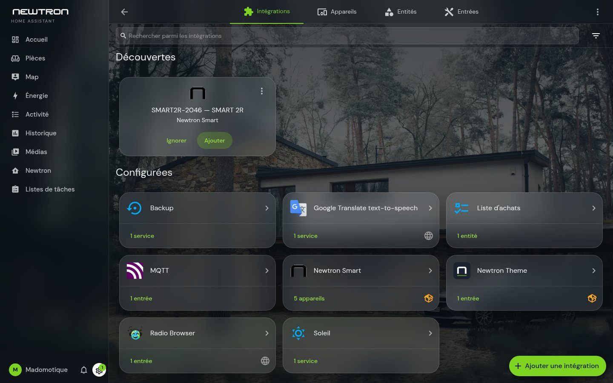

**All boards in one place**

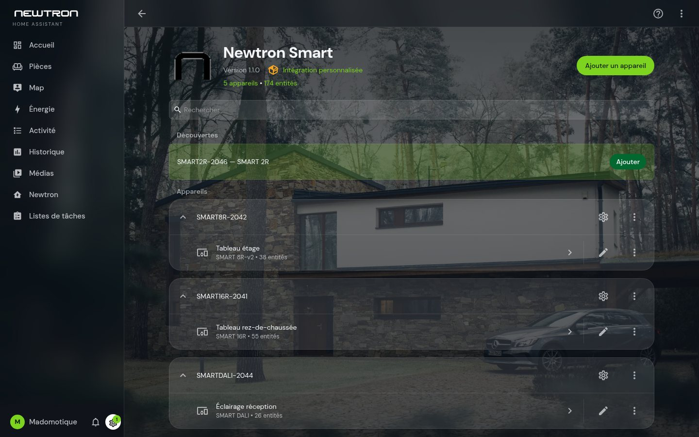

**A board and its controls**

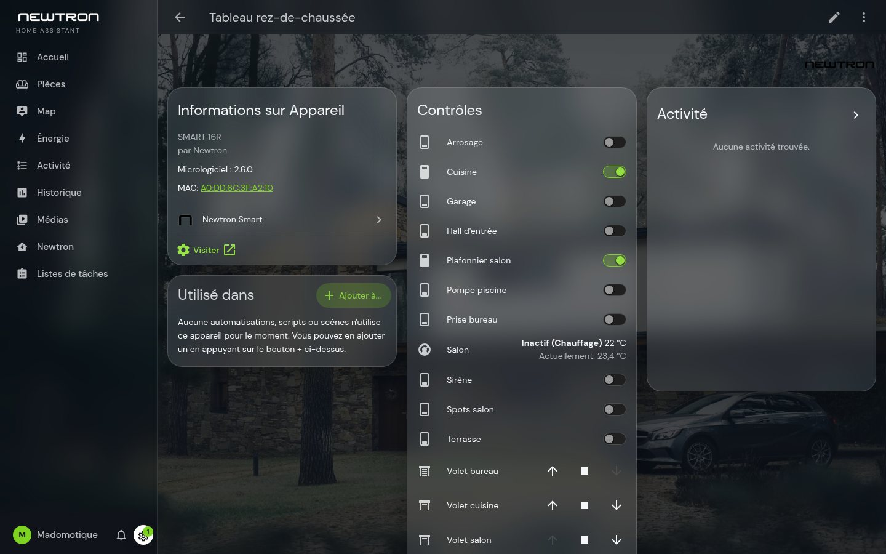

**Everything sorted by room**

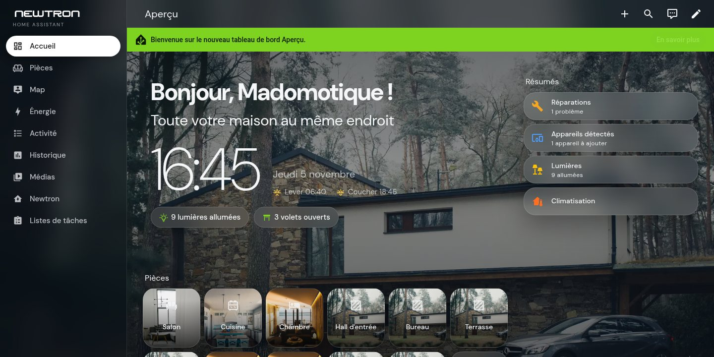

### Newtron panel

**Live inputs and outputs, identity, network**

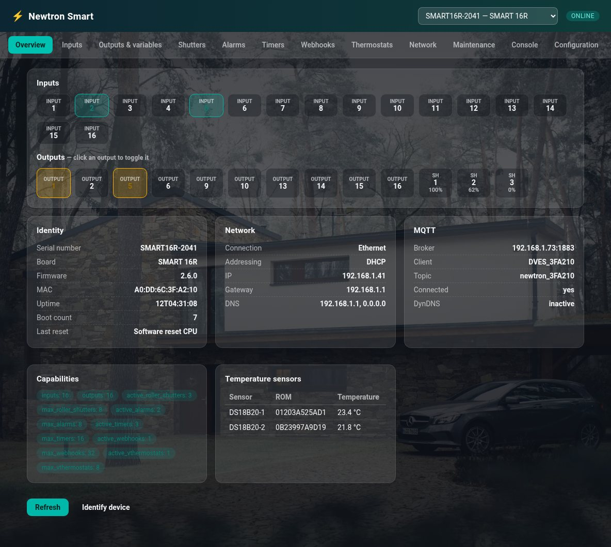

**Roller shutters**

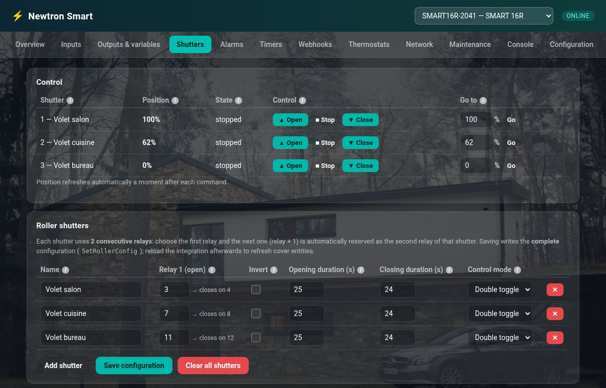

**Timers: fixed time, sunrise, sunset, prayer times**

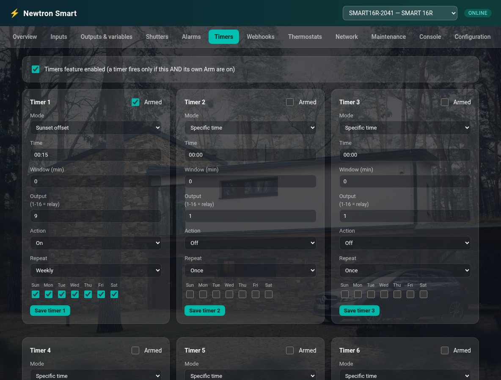

**Firmware, location, hardware revision**

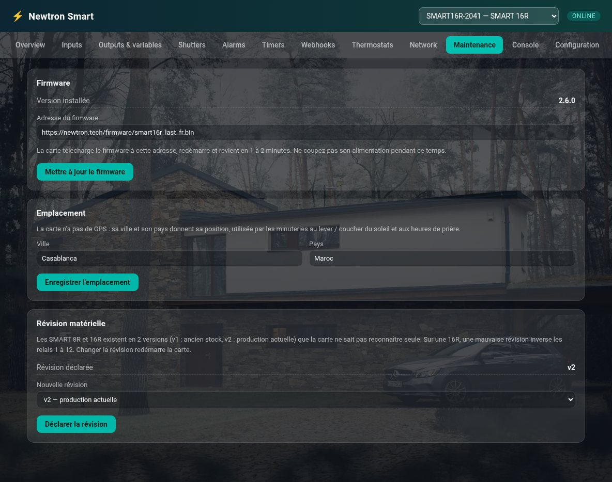

### Preparing an installation

**The boards of the site**

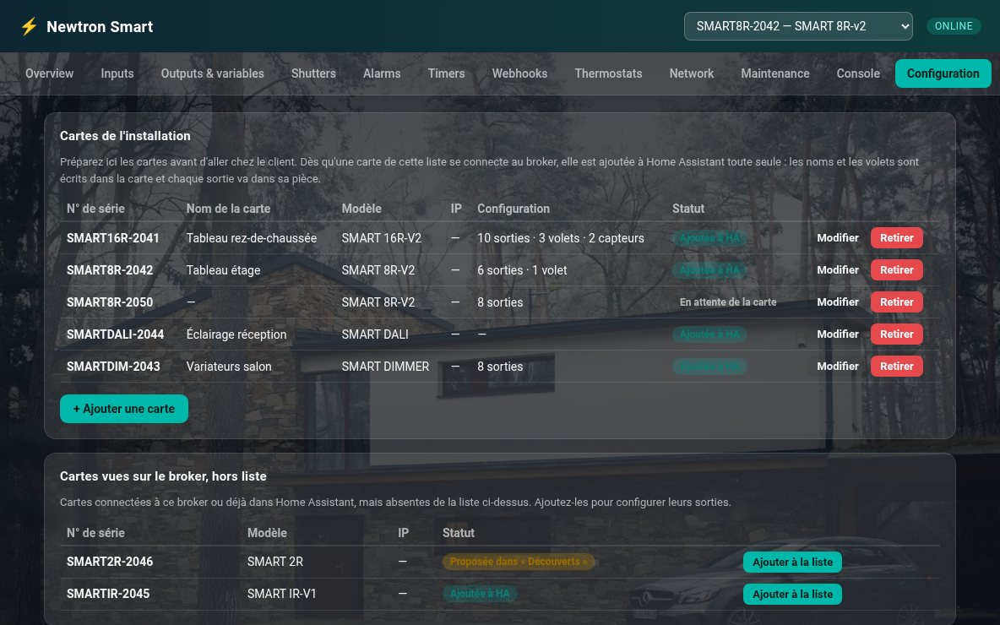

**Prepare a board before it is installed**

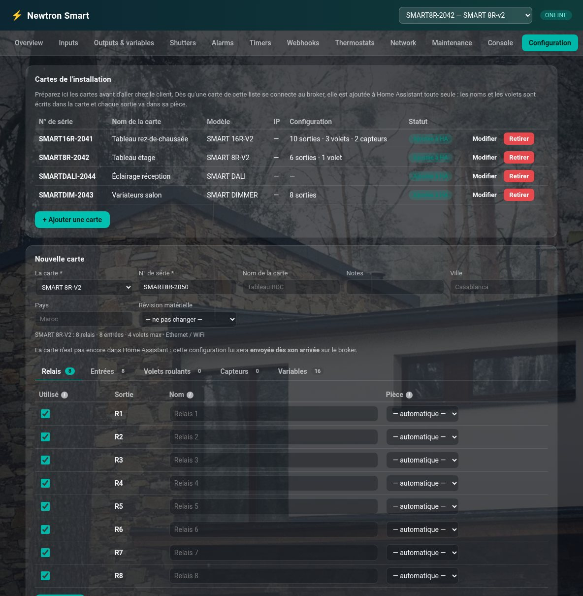

**Name and room of each output**

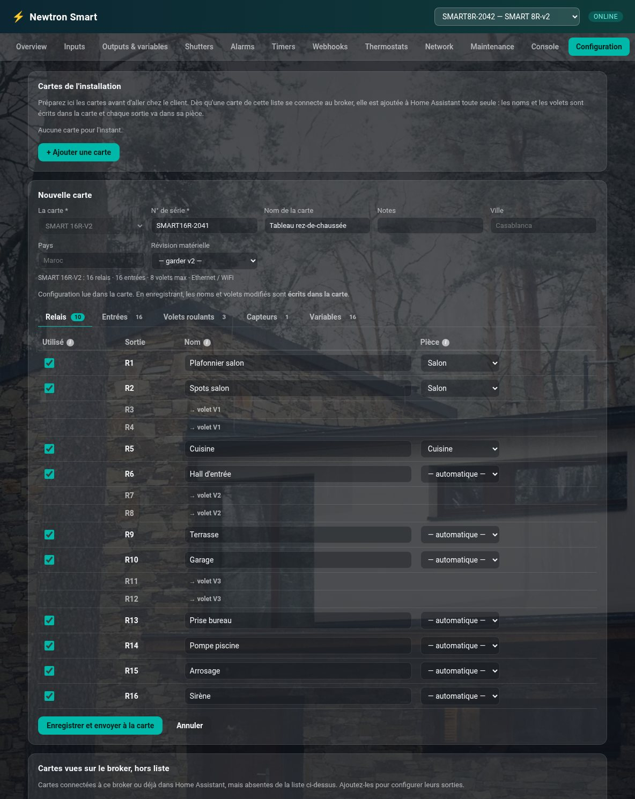

### Other boards

**SMART DIMMER**

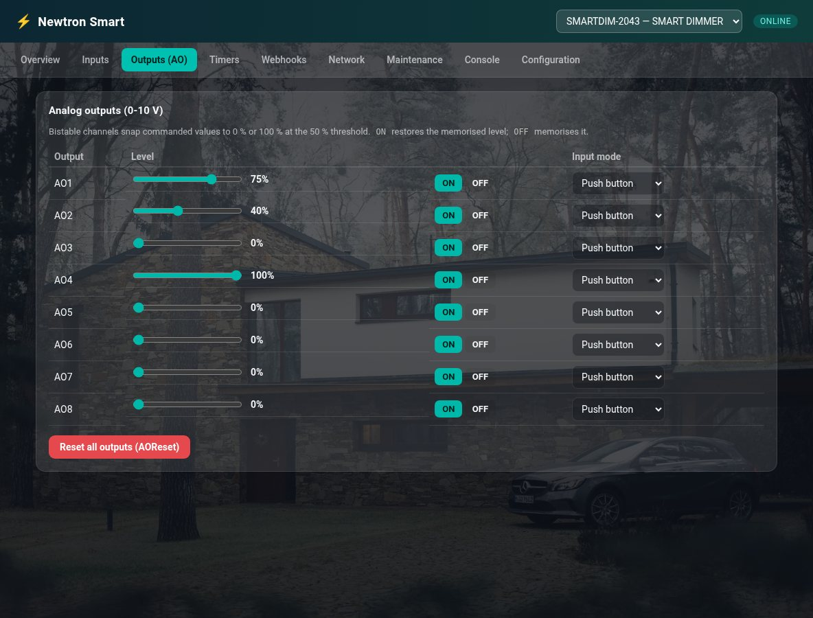

**SMART DALI**

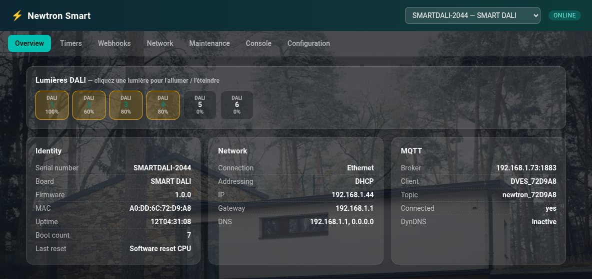

**SMART IR**

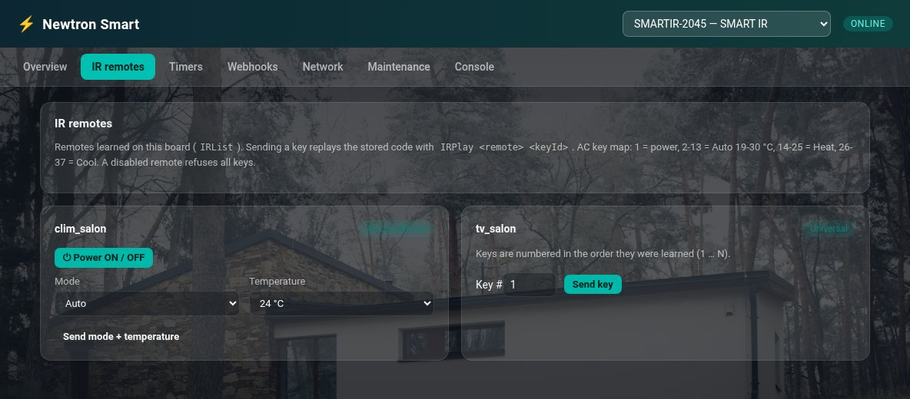

## Requirements

- Home Assistant 2026.8 or newer
- The MQTT integration configured in Home Assistant, connected to a broker (e.g. the Mosquitto broker add-on)
- Each Newtron board configured, on its own web interface, to connect to **that same broker** (host, port, username, password)

## Installation

### Via HACS

1. HACS → Integrations → search for **Newtron Smart** (or add this repository as a custom repository if it isn't in the default list yet: `https://github.com/Ilumen-MAdomotique/ha-newtron`, category *Integration*)
2. Install, then restart Home Assistant

### Manual

1. Copy `custom_components/newtron` into your Home Assistant `config/custom_components/` directory
2. Restart Home Assistant

## Configuration

Settings → Devices & services → Add integration → **Newtron Smart**

- **Search the MQTT broker for devices** — lists boards already announced on your broker
- **Enter the serial number manually** — for boards that didn't answer the search

## License

MIT — see [LICENSE](LICENSE).
